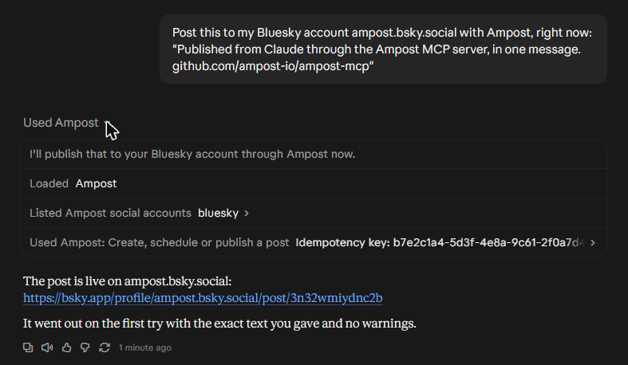
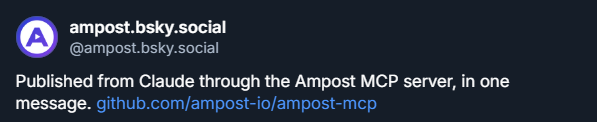

# Ampost MCP server

[](https://hookmcp.com)
[](https://glama.ai/mcp/connectors/io.ampost/mcp)
[](https://mcptry.com/servers/io.ampost/mcp)

The official remote [MCP](https://modelcontextprotocol.io) server for
[Ampost](https://ampost.io?ref=github), the social media publishing API. Your AI agent can post,
schedule, queue and analyze posts on Instagram, Facebook, Threads, X, YouTube, Pinterest, Bluesky,
Telegram and Discord (LinkedIn and TikTok are coming soon) through one connection.

```text
https://api.ampost.io/mcp
```

Ampost hosts the server: there is nothing to install or run. It speaks Streamable HTTP and signs you
in with OAuth, or takes an API key. This repo holds its listing and client configs; the server code
lives in Ampost itself.

One message in Claude, one call to the server, and the post is live:

<p>
  
  
</p>

## Connect

You need an [Ampost account](https://ampost.io/register?ref=github). The Free plan works; scheduling
and queues need a paid plan ([pricing](https://ampost.io/pricing?ref=github)).

**Claude Code**

```bash
claude mcp add --transport http --scope user ampost https://api.ampost.io/mcp
```

Then run `/mcp`, pick `ampost` and sign in in the browser. Only read access is selected at first: choose Full access, or tick the write scopes, to let the agent post. Want skills too? The
[`ampost-skills`](https://github.com/ampost-io/ampost-skills) plugin adds this server and seven
ready-made skills (post everywhere, blog to posts, schedule a week, and more).

**Claude (claude.ai and the apps)**: Settings, Connectors, Add custom connector, URL
`https://api.ampost.io/mcp`.

**ChatGPT**: turn on developer mode and add a custom connector with the URL `https://api.ampost.io/mcp`; it signs in with your Ampost account.

**Cursor**: the Add to Cursor button in the [Cursor guide](https://ampost.io/docs/mcp/cursor?ref=github), or put this in `.cursor/mcp.json`:

```json
{ "mcpServers": { "ampost": { "url": "https://api.ampost.io/mcp" } } }
```

**VS Code** (1.102 or later, with GitHub Copilot): add this to `.vscode/mcp.json`, then sign in when the server starts:

```json
{ "servers": { "ampost": { "type": "http", "url": "https://api.ampost.io/mcp" } } }
```

**Gemini CLI**

```bash
gemini extensions install https://github.com/ampost-io/ampost-mcp
```

**Codex**

```bash
codex mcp add ampost --url https://api.ampost.io/mcp
codex mcp login ampost
```

Windsurf, Devin and other clients: the
[install guide](https://ampost.io/docs/mcp/install?ref=github).

### With an API key

For CI, headless agents or clients without OAuth, create an
[API key](https://ampost.io/app/settings/api-keys?ref=github) and send it as a header:

```text
Authorization: Bearer amp_live_YOUR_KEY
```

A key can be read-only or scoped to what the agent needs.

## Tools

43 tools. `posts_create`, `posts_import_csv`, `posts_publish`, `posts_retry`, `accounts_connect`,
`platform_sets_create`, `webhooks_create` and `feedback_submit` take an idempotency key, so a retried
call never acts twice.

| Group | Tools |
| --- | --- |
| Posts | `posts_create`, `posts_validate`, `posts_publish`, `posts_update`, `posts_get`, `posts_list`, `posts_retry`, `posts_delete`, `posts_unpublish`, `posts_edit_published`, `posts_import_csv` |
| Media | `media_upload_create`, `media_upload_status` |
| Accounts | `accounts_list`, `accounts_get`, `accounts_connect`, `accounts_connect_status`, `accounts_disconnect`, `accounts_list_boards`, `accounts_set_board`, `accounts_set_analytics` |
| Platforms and sets | `platforms_list`, `platform_sets_list`, `platform_sets_get`, `platform_sets_create`, `platform_sets_update`, `platform_sets_delete` |
| Queue | `queue_get`, `queue_slots`, `queue_update` |
| Analytics | `analytics_overview`, `analytics_posts`, `analytics_followers` |
| Webhooks | `webhooks_list`, `webhooks_get`, `webhooks_create`, `webhooks_update`, `webhooks_delete`, `webhooks_test`, `webhooks_deliveries_list`, `webhooks_redeliver` |
| Help | `docs_search`, `feedback_submit` |

Try: "List my Ampost platforms", "Post this to all my accounts tomorrow at 9:00", "How did my posts
do this week?"

## What's in the repo

```text
server.json             the entry in the official MCP Registry (io.ampost/mcp)
.mcp.json               client config for Claude Code, Cursor and other clients
gemini-extension.json   Gemini CLI extension
assets/                 the screenshots above
```

## Links

- [MCP server docs](https://ampost.io/docs/mcp?ref=github) and [API docs](https://ampost.io/docs?ref=github)
- SDKs: [Node](https://github.com/ampost-io/ampost-node), [Python](https://github.com/ampost-io/ampost-python), [Ruby](https://github.com/ampost-io/ampost-ruby), [CLI](https://github.com/ampost-io/ampost-cli)
- Automation: [n8n node](https://github.com/ampost-io/n8n-nodes-ampost), [Make app](https://github.com/ampost-io/make-ampost)
- [Privacy](https://ampost.io/privacy?ref=github) and [terms](https://ampost.io/tos?ref=github)
- Support: support@ampost.io

MIT licensed (this repo's configs and docs).

<!-- mcppedia-verify-40e2e35b0f09970883fb2895e929eaed -->
